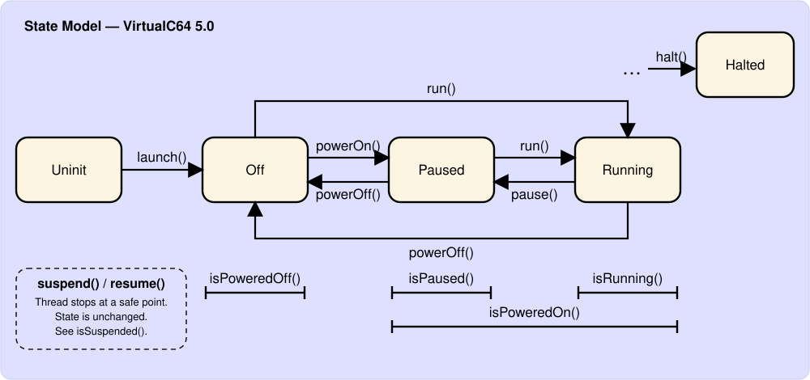

# State Model {#statemodel}

## Overview
After launching, the emulator runs as a single thread alongside the front-end. The thread lives as long as the emulator object, but it does not compute frames all the time. What it does is controlled by the execution state:

* **Uninit:** The emulator object exists, but the thread has not been launched yet (see [launch()](vc64-VirtualC64.md#launch) and [isLaunched()](vc64-VirtualC64.md#islaunched)).
* **Off:** The emulator is powered off.
* **Paused:** The emulator is powered on, but no frames are computed.
* **Running:** The emulator is powered on and computes frames.
* **Halted:** The emulator thread has been terminated. This is the last step of the shutdown procedure.

The states Off, Paused, Running, and Halted are the values of the enumeration [vc64::ExecState](grp_emulator.md#execstate). A state change is requested with the functions shown in the diagram. Like all state-changing functions, they come in a blocking and an asynchronous flavor (for example [run()](vc64-VirtualC64.md#run) and [runAsync()](vc64-VirtualC64.md#runasync), see [Threading and Errors](page-guide_threading.md#guide_threading_1md__2_users_2hoff_2_retro_2virtualc64_2_manual_2_doxygen_2build_2guides_2threading)).

The functions [isPoweredOff()](vc64-VirtualC64.md#ispoweredoff), [isPaused()](vc64-VirtualC64.md#ispaused), [isRunning()](vc64-VirtualC64.md#isrunning), and [isPoweredOn()](vc64-VirtualC64.md#ispoweredon) query the state. Running an emulator that is powered off switches it on first. If a required ROM is missing, [run()](vc64-VirtualC64.md#run) throws a [CoreError](vc64-CoreError.md#coreerror). [checkReady()](vc64-VirtualC64.md#checkready) performs the same check without running the emulator.

## Suspension
Independent of the execution state, the emulator thread can be *suspended* for a short period of time with [suspend()](vc64-API.md#suspend). A suspended thread stops at a safe point (it is neither computing a frame nor carrying out commands) and continues once [resume()](vc64-API.md#resume) has been called. The execution state does not change. [isSuspended()](vc64-VirtualC64.md#issuspended) reports whether a suspension is active. See [Threading and Errors](page-guide_threading.md#guide_threading_1md__2_users_2hoff_2_retro_2virtualc64_2_manual_2_doxygen_2build_2guides_2threading) for the rules that apply to suspensions.

## Synchronization
The emulator thread does not run freely. To compute the proper number of frames per second, it waits for an external wake-up signal and then computes all frames that are missing. The front-end sends the signal by calling [wakeUp()](vc64-VirtualC64.md#wakeup). The best moment is right after the current texture has been handed over to the GPU, which usually coincides with a VSYNC pulse. If the thread falls too far behind, it resynchronizes itself instead of trying to catch up.

## Warp mode
To speed up emulation (e.g., during disk accesses), the emulator can be put into *warp mode*. In this mode, timing synchronization is disabled and the emulator runs as fast as possible. Several clients can request warp mode independently by using different sources (see [warpOn()](vc64-VirtualC64.md#warpon)). The mode stays on as long as at least one source has requested it. The option [C64_WARP_MODE](grp_emulator.md#opt) selects when warp mode is entered automatically.

## Track mode
Similar to warp mode, the emulator can be put into *track mode* (see [trackOn()](vc64-VirtualC64.md#trackon)). A GUI enables it while its debugger is open. In track mode, several time-consuming tasks are performed that are usually left out. For example, the CPU records all executed instructions in a trace buffer.

